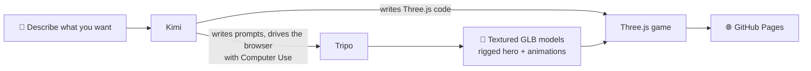

<div align="center">

<a href="https://wh1tzz.github.io/above-the-desk/"></a>

# Above the Desk · 书桌之上

**Midnight. Above the desk, a long journey begins.**

A cinematic Three.js desk-exploration game, coded by AI with AI-generated 3D models

[](https://wh1tzz.github.io/above-the-desk/)


[简体中文](README.md) · **English**

[Journey](#-the-journey) · [Features](#-features) · [Controls](#-controls) · [Screenshots](#-screenshots) · [AI pipeline](#-ai-pipeline) · [Under the hood](#-under-the-hood) · [Credits](#-asset-credits)

</div>

---

## 🌙 The journey

A tiny courier wakes up on a giant's desk.

> A pencil becomes a bridge.<br>
> Don't let it see you.<br>
> Leap across the gap.<br>
> Board the night line.<br>
> Press the typewriter and print the lost pages.<br>
> The giant's old things are piled into an attic.

## ✨ Features

- 🕯️ **A study at giant scale**: ink bottles, teacups, a globe, a gramophone, a typewriter. Every old object is terrain to climb.
- ✏️ **Desktop mechanisms**: pencils become narrow bridges, levers raise passages, book stacks become platforms, ladders lead up high.
- ✋ **Stealth**: the giant's hand reaches down; crouch behind cover to stay unseen.
- 🚂 **The night train**: ride the NIGHT LINE toy train between the bookshelves.
- ⌨️ **A typewriter bridge**: press the giant typewriter and three lost pages print one by one, forming a path to the attic cottage.
- 🎬 **Cinematic cameras**: every area has its own follow camera and framing.
- 💾 **Checkpoints and autosave**: progress survives a page refresh.

## 🎮 Play

Open **[wh1tzz.github.io/above-the-desk](https://wh1tzz.github.io/above-the-desk/)** and press `Enter`.

Desktop Chrome or Edge recommended (WebGL 2 required). Headphones recommended.

## 🕹️ Controls

| Key | Action |
| --- | --- |
| `A` / `D` or `←` / `→` | Move left / right |
| `W` / `S` or `↑` / `↓` | Move in depth |
| `Space` | Jump |
| `E` | Interact (levers, typewriter, items) |
| `C` / `Ctrl` | Crouch, hide |
| `Esc` | Pause / resume |

## 📸 Screenshots


## 🤖 AI pipeline

The code was written by **Kimi**, the old objects and the hero were generated by **Tripo**, and everything comes together in **Three.js** as a playable world.



### Tools

| Tool | Role in this project |
| --- | --- |
| [**Kimi**](https://www.kimi.com) | Wrote all the game code: levels, mechanisms, character control, cameras, saving, audio. It also wrote the Tripo prompts and generated the models by driving a browser with Computer Use |
| [**Tripo**](https://www.tripo3d.ai) | Generated the scene props (Smart Mesh P2.0 with textures) and the hero, the "paper courier", including its rig and animations |
| [**Three.js**](https://threejs.org) | Real-time rendering: PBR materials, dynamic lights and shadows, fog and bloom, skeletal animation |
| **TypeScript** + **Vite** | Project setup and build |
| **Playwright** | Automated smoke tests and full playthrough tests |

### Assets at a glance

| Asset | Notes |
| --- | --- |
| Scene models | 40 Tripo-generated objects: typewriter, gramophone, toy train, globe, armillary sphere, sewing machine, chess set, birdcage, attic cottage… |
| Hero | Tripo Smart Mesh on a humanoid preset rig, with 12 animations: idle, run, jump, crouch, sneak, crawl, climb, balance, push, lever, turn left, turn right |
| Giant hand | Generated and rigged with Tripo |
| Textures | Exported at 8K, shipped as optimized 2K versions |

## 🛠️ Under the hood

- **Three.js r180 + WebGL 2**: PBR materials, soft shadows, fog layers and bloom post-processing.
- **Animation state machine**: each animation is exported as its own GLB, merged onto one skeleton in game and cross-faded.
- **Custom collision and platforming**: gravity, jump buffering, steps, moving platforms (train, elevator) and narrow-bridge balance.
- **Stable input under fixed cameras**: movement direction stays consistent across camera cuts, so you don't drift sideways on narrow bridges.
- **Web Audio**: rain ambience, a study nocturne and jump and train sound effects mixed in layers.
- **Local saves**: checkpoints and unlocked mechanisms are stored in the browser.

## 📦 About this repository

This repository holds the **published web build** (`index.html` + `assets/`), served directly by GitHub Pages. To run it locally, serve the root with any static server:

```bash
git clone https://github.com/Wh1tZz/above-the-desk.git
cd above-the-desk
npx serve .
```

## 🎨 Asset credits

**PBR textures (CC0)**

- ambientCG: [Wood051](https://ambientcg.com/view?id=Wood051), [WoodFloor051](https://ambientcg.com/view?id=WoodFloor051), [Metal032](https://ambientcg.com/view?id=Metal032)
- Poly Haven: [book_pattern](https://polyhaven.com/a/book_pattern), [leather_red_02](https://polyhaven.com/a/leather_red_02)

**Sound effects (CC0)**

- Jump: [Jumping man sounds](https://opengameart.org/content/jumping-man-sounds) by IgnasD (OpenGameArt)
- Shout: [young boy saying Hey clearly](https://freesound.org/people/SkyRaeVoicing/sounds/363588/) by SkyRaeVoicing (Freesound)
- Toy train: [The Little Stereo Engine That Could](https://freesound.org/people/Dartcheff/sounds/464998/) by Dartcheff (Freesound)
- Train whistle: [Toy Train Whistle Soft](https://freesound.org/people/timgormly/sounds/162817/) by timgormly (Freesound)

See the LICENSE files in `assets/audio/` for details.

All game scenes and UI are original work.

<div align="center">

<br>

**If you enjoyed the journey, a ⭐ Star means a lot**

</div>
