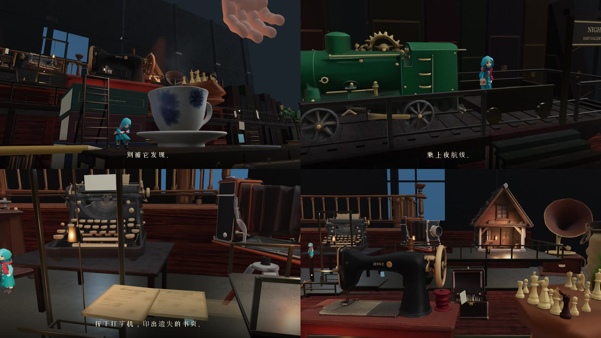
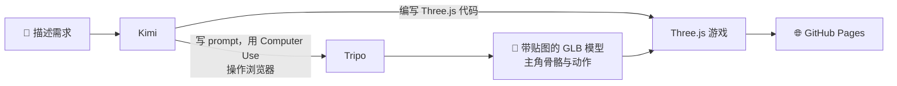

<div align="center">

<a href="https://wh1tzz.github.io/above-the-desk/"></a>

# 书桌之上 · Above the Desk

**午夜，书桌之上，有一段漫长的旅程。**

一款用 AI 写代码、用 AI 生成模型的 Three.js 电影化 3D 桌面探索游戏

[](https://wh1tzz.github.io/above-the-desk/)


[English](README.md) · **简体中文**

[旅程](#-旅程) · [玩法特色](#-玩法特色) · [操作](#-操作) · [截图](#-截图) · [AI 制作流程](#-ai-制作流程) · [技术实现](#-技术实现) · [素材来源](#-素材来源)

</div>

---

## 🌙 旅程

一个小小的信使，在巨人的书桌上醒来。

> 铅笔成了桥。<br>
> 别被它发现。<br>
> 跃过鸿沟。<br>
> 乘上夜航线。<br>
> 按下打字机，印出遗失的书页。<br>
> 巨人的旧物，堆成了阁楼。

## ✨ 玩法特色

- 🕯️ **巨人尺度的书房**：墨水瓶、茶杯、地球仪、留声机、打字机……每一件旧物都是一座需要翻越的地形。
- ✏️ **桌面机关**：铅笔架成窄桥，拉杆升起通道，书堆之间跳跃，梯子通往高处。
- ✋ **潜行与躲藏**：巨人的手会伸下来，蹲在掩体后才能不被发现。
- 🚂 **夜航小火车**：乘上 NIGHT LINE 玩具火车，穿过书架之间。
- ⌨️ **打字机纸桥**：按下巨型打字机，三页遗失的书页依次印出，铺成通往阁楼小屋的路。
- 🎬 **电影化镜头**：每个区域都有专门设计的跟随镜头和构图。
- 💾 **检查点与自动存档**：刷新页面也不会丢失进度。

## 🎮 立即游玩

打开 **[wh1tzz.github.io/above-the-desk](https://wh1tzz.github.io/above-the-desk/)**，按 `Enter` 开始。

推荐使用桌面版 Chrome 或 Edge（需要 WebGL 2），建议戴上耳机。

## 🕹️ 操作

| 按键 | 行为 |
| --- | --- |
| `A` / `D` 或 `←` / `→` | 左右移动 |
| `W` / `S` 或 `↑` / `↓` | 前后纵深移动 |
| `Space` | 跳跃 |
| `E` | 互动（拉杆、打字机、拾取物品） |
| `C` / `Ctrl` | 蹲下、躲藏 |
| `Esc` | 暂停 / 继续 |

## 📸 截图



## 🤖 AI 制作流程

这款游戏的代码由 **Kimi** 编写，场景里的旧物和主角由 **Tripo** 生成，最后在 **Three.js** 里组装成可以玩的世界。



### 用到的工具

| 工具 | 在项目中的作用 |
| --- | --- |
| [**Kimi**](https://www.kimi.com) | 编写全部游戏代码：关卡、机关、角色控制、镜头、存档、音频；撰写 Tripo 的生成 prompt，并通过 Computer Use 操作浏览器完成模型生成 |
| [**Tripo**](https://www.tripo3d.ai) | 生成场景中的旧物模型（智能网格 P2.0 + 贴图）；生成主角“纸信使”并完成骨骼绑定与动作 |
| [**Three.js**](https://threejs.org) | 实时渲染：PBR 材质、动态光影、雾与 Bloom、骨骼动画 |
| **TypeScript** + **Vite** | 工程与构建 |
| **Playwright** | 自动化冒烟测试与通关流程测试 |

### 资源一览

| 资源 | 说明 |
| --- | --- |
| 场景模型 | 40 件 Tripo 生成的旧物：打字机、留声机、玩具火车、地球仪、天象仪、缝纫机、棋盘、鸟笼、阁楼小屋…… |
| 主角 | Tripo 智能网格生成，预设人形骨架，12 组动作：待机、奔跑、跳跃、蹲下、潜行、爬行、攀爬、平衡、推、拉杆、左转、右转 |
| 巨手 | Tripo 生成并绑定骨骼的巨人之手 |
| 贴图 | 原始 8K 导出，游戏内使用 2K 优化版本 |

## 🛠️ 技术实现

- **Three.js r180 + WebGL 2**：PBR 材质、动态阴影、雾层与 Bloom 后处理。
- **动作状态机**：每组动作单独导出为 GLB，游戏内合并到同一骨架，淡入淡出切换。
- **自写碰撞与平台物理**：重力、跳跃缓冲、台阶、移动平台（火车、电梯）、窄桥平衡。
- **固定电影镜头下的稳定输入**：镜头切换时保持移动方向不变，避免在窄桥上侧向漂移。
- **Web Audio**：环境雨声、书房夜曲与跳跃、火车等音效分层混音。
- **本地存档**：检查点和机关解锁状态保存在浏览器本地。

## 📦 关于本仓库

本仓库是 **网页版的发布构建**（`index.html` + `assets/`），由 GitHub Pages 直接托管。克隆后用任意静态服务器打开根目录即可在本地运行：

```bash
git clone https://github.com/Wh1tZz/above-the-desk.git
cd above-the-desk
npx serve .
```

## 🎨 素材来源

**PBR 贴图（CC0）**

- ambientCG：[Wood051](https://ambientcg.com/view?id=Wood051)、[WoodFloor051](https://ambientcg.com/view?id=WoodFloor051)、[Metal032](https://ambientcg.com/view?id=Metal032)
- Poly Haven：[book_pattern](https://polyhaven.com/a/book_pattern)、[leather_red_02](https://polyhaven.com/a/leather_red_02)

**音效（CC0）**

- 跳跃：[Jumping man sounds](https://opengameart.org/content/jumping-man-sounds)，IgnasD（OpenGameArt）
- 呼喊：[young boy saying Hey clearly](https://freesound.org/people/SkyRaeVoicing/sounds/363588/)，SkyRaeVoicing（Freesound）
- 玩具火车：[The Little Stereo Engine That Could](https://freesound.org/people/Dartcheff/sounds/464998/)，Dartcheff（Freesound）
- 火车汽笛：[Toy Train Whistle Soft](https://freesound.org/people/timgormly/sounds/162817/)，timgormly（Freesound）

详细许可说明见 `assets/audio/` 下的 LICENSE 文件。

全部游戏场景与界面均为原创实现。

<div align="center">

<br>

**喜欢这段旅程的话，欢迎点个 ⭐ Star**

</div>
